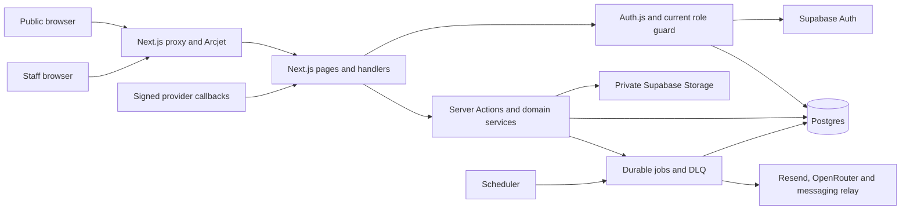

# TAC-XPRESS architecture

Source baseline **98f3e42**. The repository implements a single New Delhi ⇄ Imphal cargo operation. The public site presents air and surface services, receives inquiries and feedback, and displays published tracking updates. Provisioned staff and admins use the workspace to book cargo, move it through custody, bill customers and resolve service requests. The customer role and customer records do not confer workspace access. See [feature inventory](feature-inventory.md) and [route map](route-map.md).

## Application boundaries

## Application stack

| Boundary | Current implementation |
| --- | --- |
| Runtime and tooling | Next.js 16.4.3 App Router, React 19.2.4, TypeScript 5.9.3 in strict mode and pnpm 9.4.0. Node 22 or later is declared. `package.json`, `pnpm-lock.yaml`, `tsconfig.json` |
| UI | Tailwind CSS 4.3.0, semantic tokens in `app/globals.css` and `app/typeset.css`, local shadcn and ReUI primitives backed by Radix and Base UI, TanStack Table, Motion and Kokonut navigation. Inter and IBM Plex Mono load through `next/font`. `DESIGN.md` and `AGENTS.md` govern UI edits. |
| Client state | React local state, `nuqs` for URL-backed register controls, React Query with a one-minute default stale time, and next-themes. Client islands own interactive controls. The landing page is a client composition. |
| Forms and mutations | React Hook Form and Zod in feature forms, Next.js Server Actions and `next-safe-action`. `lib/safe-action.ts` supplies a staff-guarded action client. |
| Persistence | Drizzle 0.45.2 and postgres.js 3.4.9 operate on Postgres. `lib/db/index.ts` prefers the configured pooler URL and disables prepared statements. Production uses at most one connection per instance. `lib/db/schema.ts`, `drizzle/` and `supabase/migrations/` describe local schema and migration history. |
| Identity and object storage | NextAuth 5 beta credentials sessions backed by Supabase Auth and a current local application role. Supabase JS and SSR are declared. Privileged Supabase operations and private object storage use server-side clients. |
| Validation and operations | Vitest, Playwright, axe, Storybook, ESLint, Stylelint and a token audit. Arcjet at the request perimeter, Sentry for exceptions and PostHog for analytics. `vercel.json` and GitHub workflows define scheduling and release workflows. |

## Requests and authorization

1. `proxy.ts` intercepts matched Next.js requests. It screens abuse with Arcjet, redirects anonymous workspace traffic and performs a session-role check. Production handling distinguishes public information reads from private routes or mutations during a protection outage.
2. `auth.ts` verifies Supabase Auth credentials and an eligible staff record or completes a verified MFA flow. `app/(auth)/signin` and `app/actions/mfa-actions.ts` expose the sign-in, authenticator, recovery-code and passkey flows. The Auth.js handler provides session and callback operations.
3. `lib/auth/guards.ts` rechecks the current, non-deleted `users` row for page, action and API authorization. `app/dashboard/layout.tsx` and `app/driver/layout.tsx` mount the authenticated shell. Staff management and jobs require admin access. Per-operation guards matter because a hidden navigation link grants no data protection.
4. Server Components read records using Drizzle after the guard. Related actions validate inputs, enforce operation-specific rules, persist the result and invalidate affected routes. Elevated database and storage access depends on application guards in addition to database policy.
5. Dashboard and analytics aggregates use short-lived server caches in `app/dashboard/page.tsx`, `lib/control-center.ts` and `lib/dashboard-metrics.ts`. Main registers parse URL filters and fetch bounded pages through Drizzle. Fleet tracking and workspace activity use authorized application reads.

## Data flow and ownership

| Workflow | Input → processing → persistence or output |
| --- | --- |
| Cargo booking | Invoice wizard or shipment register → authenticated actions and shared freight calculations → `shipments`, `invoices`, `tracking_events` and audit. The wizard uses an idempotency key and a transaction. See `app/dashboard/invoices/actions.ts`, `lib/invoices/persistence.ts` and `lib/stem/`. |
| Custody | Dispatch and manifest actions assign compatible shipments to pickup, line-haul or delivery loads → scan, departure and per-AWB handoff operations use shared rules → `manifests`, `manifest_items`, `manifest_item_handoffs`, `shipment_legs`, shipment state and audit. A final delivery receipt can include a signature. See `lib/shipments/` and `app/driver/delivery/`. |
| Public tracking | AWB → validation and rate controls in `app/actions/tracking.ts` → limited shipment and public-event projection in `lib/tracking/public-query.ts`. The support AI reads the same projection. The audit branch requires a published event through an inner join. The baseline left join allowed limited metadata before event publication. Staff shipment details display internal events as well. |
| Billing and documents | Invoice records and integer-paise totals → guarded invoice and label pages or signed render jobs → print/PDF, private Supabase Storage or an approved provider send. Cargo uploads and staff avatars use distinct paths in the private bucket. See `lib/documents/` and `app/api/cargo-documents/`. |
| Customer service | Public contact or supported inbound webhook → ticket persistence, audit and durable jobs → staff inbox, triage and acknowledgment. `after()` attempts immediate processing. Scheduled recovery claims jobs with leases and sends bounded provider requests. Admin DLQ tools handle failed and uncertain jobs. See `lib/support/`, `lib/jobs/`, `app/api/cron/` and `app/actions/dlq-actions.ts`. |
| Fleet and network | Staff maintain drivers, vehicles and hubs. A mobile bearer integration writes newer observations for known active vehicles to `fleet_telemetry`. The staff tracking station reads recent positions. See `app/api/fleet/telemetry` and `lib/fleet-telemetry-store.ts`. |

## Integration boundaries

- Supabase serves Postgres, Auth and private Storage. `supabase/functions/` contains edge functions for capabilities and invoice PDFs. The Next.js application also has its own capabilities route and renders downloadable invoices through its document endpoints. Check [database audit](database-audit.md) for hosted migration and policy evidence.
- LeminAI/WPBox handles supported outbound WhatsApp sends. Meta inbound and status processing requires signed callbacks. Carrier rates remain manual and the carrier webhook refuses external custody transitions. See `lib/whatsapp/`, `app/api/webhooks/` and the integrations page.
- Resend sends acknowledgment, SLA and staff reply emails. OpenRouter serves the public AI assistant and support triage through server code. Automated outbound replies require separate activation and verification.
- Vercel schedules communications recovery, SLA checks and cleanup. `.github/workflows/communications-cron.yml` also defines scheduled recovery and SLA calls. The configured schedules are source evidence. Provider delivery, scheduler execution, capacity and recovery require environment evidence.

## Existing documentation

[Earlier architecture](../ARCHITECTURE.md), [API reference](../05-api-reference.md), and the [cargo lifecycle gate](../cargo-lifecycle-gate.md) contain deeper historical evidence. `PRODUCT.md` still describes signed customer sessions, while the route handlers and portal action stubs show that this access model was retired. The earlier architecture page lists public service, about, contact and feedback pages that now redirect to landing-page sections. Use the current [route map](route-map.md) for navigation and access, and [production readiness](production-readiness.md) for current release evidence.
