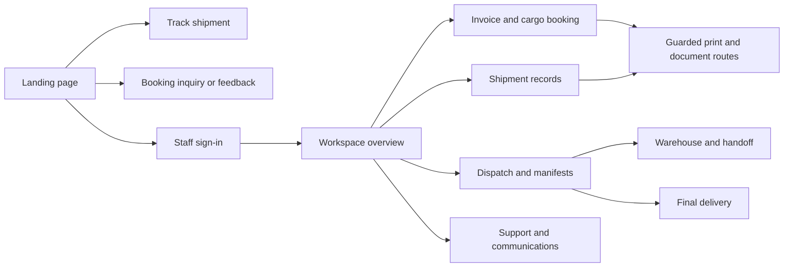

# TAC-XPRESS route map

Source baseline **98f3e42**. The App Router contains 43 page files and 24 explicit route handlers, including the retired auth callback. Metadata routes are listed separately. Source inventory comes from `git ls-files`, `next.config.ts`, `proxy.ts` and the actual link owners.

## Primary journeys

## Public pages and compatibility routes

| Destination | Entry or redirect | Access |
| --- | --- | --- |
| `/` | `app/page.tsx` → `LogisticsHome` → `#features`, `#services`, `#method`, `#pricing`, `#about`, `#faq`, `#contact`, `#feedback`. The header, hero and footer expose booking and tracking. | Public |
| `/track` | Standalone AWB form, with optional `awb` query. The landing tracking modal is available through `/?tracking=open` and nav controls. | Public |
| `/terms` | Terms, linked from public footers. `/term` redirects here. | Public |
| `/signin` | Provisioned credentials, MFA/passkey and staff recovery. The landing footer links Staff access. `/login` redirects here. | Public entry, with signed-in staff normally redirected to `/dashboard` |
| `/services`, `/services/:path*` | Permanent redirect to `/#services`. | Public |
| `/shipping-guide`, `/about`, `/contact`, `/feedback` | Permanent redirects to `/#method`, `/#about`, `/#contact`, `/#feedback` respectively. | Public |
| `/onboarding`, `/dashboard/onboarding` | Permanent redirects to `/dashboard`. The proxy also handles the older onboarding spelling. | Dashboard guard applies at destination |
| `/auth/callback` | Clears retired session cookies and redirects to `/signin?reason=staff-only`. | Public compatibility endpoint |
| `/portal`, `/portal/invoices`, `/portal/shipments`, `/portal/tickets`, `/portal/track` | Redirect to `/dashboard`, `/dashboard/invoices`, `/dashboard/shipments`, `/dashboard/messages`, `/dashboard/tracking` respectively. | Current staff or admin |
| `/docs-preview`, `/sentry-example-page` | Local document fixtures and error-reporting example. Source returns 404 in production. | Development only |
| `/robots.txt`, `/sitemap.xml`, `/manifest.webmanifest`, `/favicon.ico` | App Router metadata and icon. The sitemap currently advertises the `/login` compatibility URL. | Public |

Unknown pages use `app/not-found.tsx`. Route failures have the root error and global error boundaries. `next.config.ts` rewrites `/ingest/*` to PostHog endpoints. The optional Sentry configuration can mount a production monitoring tunnel.

## Workspace navigation

`components/operations/navigation.ts` feeds the workspace navigation. `app/dashboard/layout.tsx` and `app/driver/layout.tsx` require a current staff role. `components/operations/navigation.ts` selects the longest matching parent for nested destinations.

| Menu group or parent | Destinations |
| --- | --- |
| Daily operations | `/dashboard`, `/dashboard/shipments`, `/dashboard/dispatch`, `/dashboard/manifests`, `/dashboard/warehouse`, `/driver/delivery`, `/dashboard/tracking` |
| Network | `/dashboard/fleet`, `/dashboard/hubs`, `/dashboard/operations/air-cargo`, `/dashboard/operations/surface-cargo` |
| Business & service | `/dashboard/invoices`, `/dashboard/customers`, `/dashboard/staff` **admin**, `/dashboard/pricing`, `/dashboard/messages`, `/dashboard/feedback`, `/dashboard/communications` |
| Reporting & administration | `/dashboard/analytics`, `/dashboard/metrics`, `/dashboard/warehouse/audit`, `/dashboard/integrations`, `/dashboard/jobs` **admin**, `/dashboard/settings/security` |
| Shipment rows, scanner and activity | `/dashboard/shipments/[id]` |
| Invoice register and overview quick action | `/dashboard/invoices/create` |
| Customer ledger dialog | `/dashboard/customers/[id]/ledger` |
| Delivery route | `/driver` redirects to `/driver/delivery`. The delivery register links `/driver/delivery/[id]` and accepts an optional `manifestId` on the register. |
| Invoice previews, booking success, activities and document renderer | `/invoice/[id]`, `/invoice/[id]/label`. Current staff access or a scoped internal render token. |
| Settings compatibility | `/dashboard/settings` redirects to `/dashboard/settings/security`. |

Admin visibility matches the explicit page guard for staff management and Jobs & DLQ. Dynamic document and delivery pages also enforce their own guards. Staff-facing customer records are part of billing and shipment operations.

## HTTP handlers

| Methods and route | Entry requirement and purpose |
| --- | --- |
| GET/POST `/api/auth/[...nextauth]` | NextAuth session, CSRF and callback protocol. |
| GET `/api/auth/capabilities` | Staff session. Returns role-derived capabilities. |
| POST `/api/chat` | Public abuse-controlled assistant with bounded text input. |
| GET `/api/customers`, `/api/drivers`, `/api/hubs`, `/api/vehicles` | Staff session. Bounded search or selected record lookup. |
| GET/POST `/api/cargo-documents/[entity]/[id]` | Staff session and shipment or manifest scope. POST requires a same-origin upload. |
| GET `/api/documents`, `/api/documents/download` | Staff session. Private attachment or invoice PDF. |
| GET `/api/public/invoice-pdf` | Scoped signed PDF job. |
| GET `/api/manifests/[id]/print` | Staff session. Manifest print. |
| GET `/api/staff-avatar/[id]` | Staff session and matching owner ID. |
| GET/POST `/api/fleet/telemetry` | Staff read of recent positions. Mobile integration bearer for writes. |
| GET `/api/stream/tracking` | Staff session. Streams newest tracking event for a shipment. The current shipment-detail timeline consumes server-rendered events. |
| GET `/api/workspace-activity` | Staff session. Recent workspace activity. |
| GET `/api/health` | Staff or configured health bearer. Service diagnostics. |
| GET `/api/cron/cleanup`, `/api/cron/communications`, `/api/cron/sla-check` | Cron bearer. Retention, queue recovery and SLA work respectively. |
| POST `/api/webhooks/carrier` | HMAC-signed carrier input. |
| GET/POST `/api/webhooks/whatsapp` | Verification token for challenge and HMAC-signed callbacks for inbound/status processing. |
| GET `/api/sentry-example-api` | Development-only Sentry handler. |
| GET `/auth/callback` | Retired auth redirect described above. |

## Navigation and evidence gaps

- **VERIFIED by source** — The customer portal pages are redirects and the email registration and magic-link actions are disabled. Older public pages route to sections with matching IDs in the landing composition.
- **VERIFIED by source** — The baseline sent raw URL text into UUID comparisons and tried invoice UUID fields before the label AWB fallback. The audit branch validates identifiers in invoice, ledger, delivery and staff tracking requests. The label route uses the AWB field directly for non-UUID identifiers. Authenticated runtime checks require isolated fixtures. See [backlog](task-backlog.md).
- **UNVERIFIED** — Authenticated desktop and mobile route execution, hardware scanning, actual document rendering and all role-dependent workflow transitions need an isolated environment with approved test identities and synthetic records.

## Local browser observations

Synthetic Next development server at loopback and Chromium with outside-origin requests blocked. The homepage, track, terms and sign-in returned HTTP 200. The first homepage HTTP read took 62.0 s wall time during startup and compilation. Subsequent browser loads used fresh cache-disabled contexts and shared the development server with other checks.

| Viewport | Time to first byte | First contentful paint | Load complete | Horizontal overflow |
| --- | ---: | ---: | ---: | --- |
| 320 × 900 | 10.54 s | 14.43 s | 16.63 s | None |
| 768 × 900 | 1.43 s | 2.02 s | 3.47 s | None |
| 1440 × 900 | 2.68 s | 6.18 s | 7.49 s | None |

The three homepage runs recorded 37 script requests and 1,704,912 script transfer bytes each. These observations describe a single local development run with compilation and competing checks. A production-build measurement needs separate evidence. The mobile menu opened at 320 px and Escape returned focus to its trigger. The desktop Method link reached `#method`.

**VERIFIED on the baseline** — The homepage footer's Share feedback link set the fragment to `#feedback` but the booking form remained visible. Reloading the same URL selected feedback. The footer updates history with `pushState`, which does not publish the `hashchange` event the contact form subscribes to.

**VERIFIED on the baseline** — The reduced-motion browser console reported hydration attribute mismatches. Seven landing components rendered image classes conditional on the client motion preference, and the cinema dialog's animated wrapper rendered an extra tabindex when Motion enabled its press gesture. The actual browser preference is available to CSS before hydration. See [backlog](task-backlog.md).

### Local remediation and verification

- The footer's in-page link now signals the contact form after updating the fragment. In Chromium, it switched from booking to feedback on click, selected feedback again when activated with Enter after a manual switch to booking at the same URL, and preserved feedback mode on reload.
- Image hover transforms now use CSS motion preferences, which produce identical image class attributes during server render and hydration. The corridor dialog uses its native focusable trigger. Under reduced motion, Chromium reported no hydration mismatch, the tested image had no hover scaling, Enter opened the dialog and Escape returned focus to its trigger.
- Both targeted Playwright cases passed. Changed-file ESLint, no-emit TypeScript and diff checks passed. The ReUI scan reported existing hover and accordion motion patterns and the allowed 500 ms media-hover zoom duration. The patch keeps the existing visual motion duration and states.

The header booking CTA still uses a direct history update. Whether the CTA resets the form after an in-page visit to feedback remains unverified.
